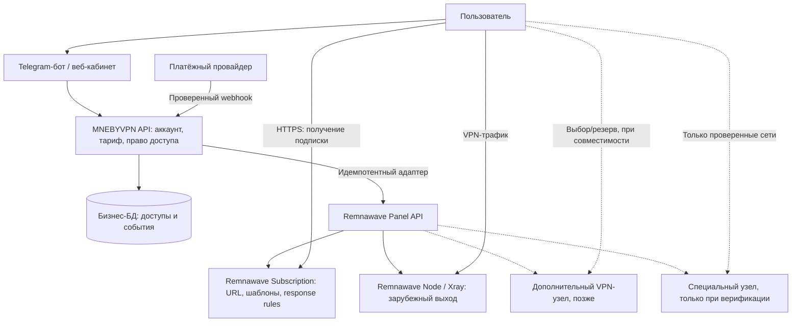

# Архитектура MNEBYVPN v1

Дата фиксации: 2026-11-05. **Документ — план, не описание уже установленного сервиса.**

## Цели и границы

- Подписка на VPN работает в **нескольких сторонних приложениях**, если конкретные протокол/транспорт и конфигурация ими поддерживаются.
- Один аккаунт MNEBYVPN, один оплаченный период; разные форматы представления одной сетевой конфигурации.
- Система масштабируется добавлением узлов, не заменой коммерческой части.
- Старт — на двух имеющихся VPS, без нового сервера; ресурсы панели должны соответствовать требованиям.
- Уже работающая инфраструктура Telegram-прокси — отдельный production-продукт; её нельзя стирать ради VPN.
- Возможность будущих специальных узлов для сетей с разрешительными списками не объявляется гарантией подключения.

## Логическая схема

**Подписка — не VPN-трафик.** Клиент обращается к URL для импорта/обновления, а затем устанавливает соединение с выбранным узлом. Формат ответа (Base64, Xray JSON, sing-box, Mihomo) не меняет сетевой протокол клиента. Нельзя обещать, что одна ссылка заработает во всех программах без отдельных правил и тестов.

## Плоскости управления

1. **Commercial plane** (разрабатываем): аккаунты, тарифы, платёжные события, сроки доступа, состояние подписки, поддержка. Источник истины об оплаченных правах — наша БД.
2. **Control plane** (upstream): Remnawave Panel, API, узлы, пользователи/ключи/квоты, шаблоны выдачи, события. Наша система через адаптер синхронизирует право на доступ в Remnawave и сверяет расхождения.
3. **Data plane** (upstream): Remnawave Node + Xray-core. Сетевой трафик идёт напрямую к назначенному узлу. Сама панель не должна пропускать пользовательский трафик.
4. **Delivery plane:** публичный HTTPS-адрес подписки и страница подключения. На MVP используем штатный Remnawave endpoint/шаблоны; собственный шлюз добавим только при доказанной потребности и без изменения адреса пользователя, если это технически возможно.

## MVP: важные сценарии

### Покупка
1. Клиент выбирает тариф.
2. Backend создаёт платёж с уникальным локальным идентификатором.
3. Backend **проверяет подпись/подлинность webhook и статус у провайдера**; событие записывается идемпотентно (provider_event_id уникален).
4. Backend атомарно продлевает entitlement в БД, помещает команду выдачи в надёжную очередь (outbox).
5. Worker создаёт/продлевает VPN-пользователя через Remnawave API, сохраняет mapping без публикации ключей.
6. После подтверждения выдаёт персональную HTTPS-ссылку подписки и инструкции. Ссылка — bearer-secret, она не публичная.

### Окончание подписки
- Entitlement переходит в expired, worker вызывает disable/revoke у Remnawave и сверяет исполнение.
- **Недостаточно** просто скрыть ссылку: существующие ключи должны перестать авторизовываться на data plane. Требуется тест с уже импортированным клиентским профилем.
- Оплата/продление после отключения снова применяет доступ. Повторные webhook не создают повторных продлений.

### Обновление и аварийный отказ узла
- URL подписки может содержать несколько проверенных узлов и альтернативных профилей.
- Клиентский auto-failover и re-fetch не универсальны; инструкции и тесты зависят от приложения.
- При падении control plane уже работающий узел может продолжать обслуживание, но выдача и обновление подписок под угрозой. Процедуру восстановления/зависимости при рестарте узла проверяем отдельно.

## Выбранные протоколы и совместимость

- **P0**: VLESS + REALITY на официальном Xray-core, профиль в изолированном пилоте.
- **P1**: XHTTP и альтернативные транспорты только после проверки клиентских версий и конфигураций.
- **P1**: Hysteria2 только после подтверждения поддержки конкретной версии Xray/Node и клиентов.
- **P2**: AmneziaWG, если потребуется, — отдельный адаптер/контур; не считать поддерживаемым Remnawave Node по умолчанию.
- **P2**: специальные входные узлы и проверенные маршруты (см. [special-nodes](special-nodes.md)).

## Данные и границы ответственности

Планируемые сущности коммерческой БД:
- `accounts` (внешние идентификаторы, статус, consent), `plans`, `entitlements`;
- `orders`, `payment_events` (unique provider id), `outbox_operations` (state, attempts, last_error);
- `provisioning_links` (account_id ↔ Remnawave user_id), `client_profiles`, `user_support_cases`.
- `node_catalog` (идентификатор, тип normal/regional/special, провайдер, статус), `node_health_samples` (ограниченный TTL, без пользовательского содержимого).

Схема не является выполненной миграцией БД; выбор ORM и точных полей отложен до разработки. Идентификаторы ключей в БД нельзя считать эквивалентом хранения приватных секретов.

## Нефункциональные требования

- Секреты хранятся вне Git, ограниченные полномочия API, TLS и проверка webhook.
- Логи без полных URL подписок и ключей. Полезная телеметрия — доступность сервиса, CPU/RAM/диск узла, успешность синхронизации.
- Backups БД/конфигураций отдельно от единственного VPS; регулярный **тест восстановления**.
- Раздельные миграции сервиса и прокси, безопасные rollback и version pinning.
- Никаких публичных API панели без отдельной политики доступа; админ-плоскость защищать сетевой изоляцией и аутентификацией.

## Предварительные ограничения

Существующие VPS: у зарубежного 1 vCPU, 1.9 GiB RAM и около 4.1 GB свободного диска; у российского 1 vCPU, около 956 MiB RAM и 4.8 GB диска свободно по read-only замерам 2026-11-05. См. [infrastructure](infrastructure.md). Ни один не отвечает всем официальным минимальным требованиям Remnawave Panel; установку панели откладываем до увеличения ресурсов.

## Источники

- https://docs.rw/install/requirements/
- https://docs.rw/api/
- https://docs.rw/learn-en/templates/
- https://docs.rw/learn-en/routing-rules/
- https://github.com/remnawave/panel
- https://github.com/remnawave/node
- https://github.com/XTLS/Xray-core
