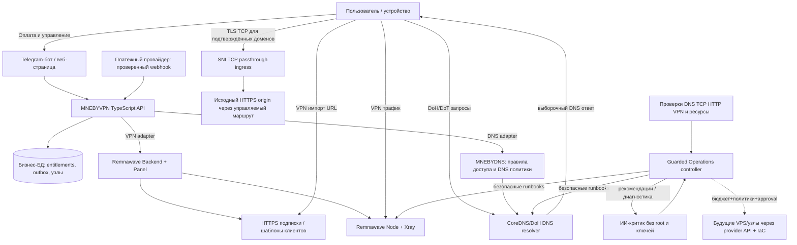

# MNEBYVPN v2 — два независимых способа подключения

**Архитектурный проект, не развёрнутый сервис (05.11.2026).**

## Общая схема

Стрелки описывают **логическое взаимодействие**, не существующие настроенные пути или открытые порты. VPN-пользователь получает URI подписки и подключается к VPN Node; DNS-пользователь выбирает DNS-профиль и, только для подтверждённых сайтов, SNI-прокси. **Smart DNS не является полным VPN и не защищает весь трафик устройства.** SNI-путь сохраняет HTTPS TLS до исходного сервера; не устанавливаем корневые CA и не выполняем MITM.

## Логика слоёв

1. **Commercial**: единый аккаунт, заказ/платёж, тариф, entitlement с `service_type` = `vpn` / `smart_dns` / `bundle`, support, self-service, обработчик outbox.
2. **VPN control/data**: Remnawave backend/панель + Node/Xray + Remnawave subscription templates/response rules. Генератор собственной «универсальной подписки» на MVP не нужен.
3. **Smart DNS control/data**: собственная служба политики DNS и конфигураций (не Remnawave); CoreDNS/DoH/DoT resolver и отдельный SNI/TCP passthrough ingress. Настройка защищённых DNS-профилей не гарантирует маршрутизацию всех приложений.
4. **Operations**: probes → метрики → правила → безвредный/runbook action → повторная проверка. ИИ только объясняет причину и выбирает из разрешённых действий, но **не управляет root shell**. Автоскейл — отдельный контроллер с тарифными/денежными лимитами и approval gates.
5. **Delivery**: управляемые нами HTTPS-имена подписок, DNS-профилей, API. Имена пока не куплены и не задействованы.

## Оплата и доступ

См. [billing-lifecycle](billing-lifecycle.md). Транзакционная БД бизнеса является источником истины оплаты; Remnawave — источник сетевого состояния VPN; MNEBYDNS policy store — источник сетевых правил DNS. Worker сверяет каждую подсистему с активными правами. Запрет полного URL подписки и токенов в логах.

## Доступность и аварии

Нет автоматической гарантийной отказоустойчивости на двух VPS. Сам VPN-узел может пережить отказ панели, но выпуск/обновление подписок и продления могут остановиться; DNS-контур тоже имеет точки отказа. Отдельный [план disaster recovery](disaster-recovery.md) и probes **снаружи** сервера.

## Приоритеты

- P0: Xray/REALITY и несколько проверенных клиентских приложений, единое право доступа, ресурсный preflight, защита текущих прокси.
- P1: собственный Smart DNS/SNI proof of concept с одним-двумя разрешёнными HTTPS-доменами; независимый resolver и routing.
- P1: мониторинг + алерты + *детерминированные* ограниченные restart/recovery с проверкой.
- P2: ИИ-критик инцидентов, approved runbooks, масштабирование через провайдеров; ни один из этих сервисов не считается реализованным.
- P3: специальные дорогие узлы для операторских ограничений, только после проверки сети и договора.

Подробнее: [smart-dns](smart-dns.md), [operations](operations-automation.md), [deployment](deployment-contract.md), [infrastructure](infrastructure.md).

Проверенные принципы: https://docs.rw/learn-en/templates/ ; https://docs.rw/learn-en/routing-rules/ ; https://github.com/coredns/coredns ; https://nginx.org/en/docs/stream/ngx_stream_ssl_preread_module.html ; https://www.rfc-editor.org/rfc/rfc6066.html.

## Gate v3: шесть инвариантов перед платной эксплуатацией

- Smart DNS и прозрачный TLS/SNI relay НЕ имеют общей автоматической subscriber auth: токен DoH не попадает в TLS ClientHello. Платный relay остаётся BLOCKED до проверенной [привязки каждого соединения к подписке и общего server-side quota enforcement](smart-dns-access-gate.md). HWID/идентификация устройств для этого не нужны.
- Любая команда выдачи VPN/DNS должна применять **последнее desired state** и защищаться `revision + fencing`; см. [порядок применения](provisioning-ordering.md).
- Новый узел не равен переносу клиентов. Для scale-out необходимы проверенные client updates, выбор и замер разгрузки; см. [scale-out](scale-out-contract.md).
- Покупка VPS возможна только после атомарного резерва бюджета с учётом ресурсов неизвестного исхода; см. [budget contract](scale-out-contract.md).
- Не подтверждено, что Remnawave Node сам отключает expired пользователей при разрыве связи с панелью; см. [offline-expiry](offline-expiry.md).
- Для Smart DNS требуются согласованные ответы A/AAAA/HTTPS/SVCB/CNAME/DNSSEC; без этого домен исключается из Smart proxy; см. [DNS RR policy](dns-record-policy.md).

**Все эти пункты спроектированы, но НЕ проверены на реальных узлах и клиентах.**

## Бизнес-модель MNEBYDNS

**Одна подписка = одна общая квота трафика без лимита устройств.** Уникальный DoH URL позволяет проверять DNS-запросы, но не является счётчиком HTTPS байтов. Каждый ingress поток должен быть связан с quota bucket подписки. Рассматриваем персональный destination IPv6 как передаваемое право доступа, а не доказательство личности, с ограничениями IPv4-only и риском расходования чужой квоты. См. [ADR-0005](decisions/0005-shared-dns-quota.md).

## ADR-0006 — совместимость DNS/VPN и баланс приватности, скорости, географического выхода

Продуктовое требование: системный Android Private DNS (DoT) и наш VPN должны сосуществовать без ручного изменения DNS на испытанных клиентах; **совместное размещение на одном VPS само по себе этого не гарантирует**. VPN должен использовать подтверждённый зарубежный egress для сервисов, ограничивающих по стране IP, но Smart DNS без SNI-прокси реальный IP не меняет. Стараться не направлять уже туннелированный VPN-трафик повторно на SNI ingress; сохранять TLS до origin, не допускать незаявленных DNS/direct leaks и измерять влияние на задержки/скорость. Совместимость и скорости пока **UNVERIFIED**, испытания до рекламных гарантий. Подробности: [ADR-0006](decisions/0006-private-dns-vpn-privacy-performance-egress.md).
