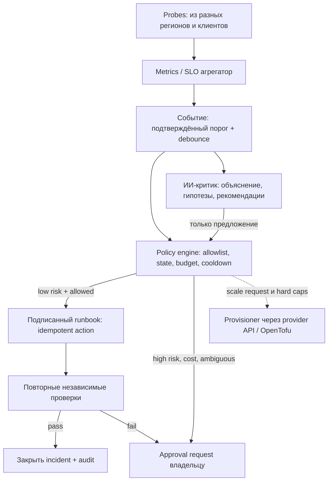

# Operations Controller — мониторинг, самовосстановление, ИИ-критик и autoscaling

**Статус: проект. Никакой автоматической покупки VPS, остановки служб или управления продом не реализовано.**

## Принцип: факты и детерминированный control loop важнее ИИ

## Наблюдаемость

- Внешние probes минимум из двух независимых мест в будущем; сейчас можно начать с частичных проверок на существующих VPS, но **самопроверка одного узла не доказывает доступность пользователю**.
- DNS: DoH/DoT status, валидность ответов, p95 latency, upstream availability, cache ошибки, rewrite consistency.
- SNI proxy: соединения, TLS handshake до origin без MITM, TCP failures, допустимые domain targets, egress/ingress bytes.
- VPN: Xray/node heartbeat, активные подключения/ошибки, capacity, latency, packet loss, доступность профиля из реальных пользовательских сетей.
- Control: subscription HTTPS response, user-provisioning sync, платежи, outbox lag, DB/Redis disk/RAM.
- VPS: RAM available, CPU utilization и **CPU steal**, swap thrash, bandwidth Mbps/packet drops, conntrack, disk free, inode, provider network counters.
- Внешние проверки возможны через https://github.com/prometheus/blackbox_exporter (HTTP(S), DNS, TCP). Не добавлять тяжёлые компоненты на существующие 1vCPU серверы до preflight.

## Классы автоматических действий

| Класс | Примеры | Режим |
|---|---|---|
| A0 read-only | метрики, хэши конфигов, логи без секретов, diff, ping | автоматически |
| A1 низкого риска | очистить **только собственный** ограниченный cache, перестроить тестовый DNS map, исключить доказанно сбойный новый узел из выдачи | автоматически после policy + cooldown |
| A2 средний риск | restart исключительно нового MNEBYVPN sidecar, rollback нового релиза, DNS routing failover | только при точном allowlist, двухсторонней проверке и заранее одобренных runbooks; изначально `dry_run` |
| A3 высокий риск | изменять существующие nginx/Xray/WireGuard/MTProxy, firewall, ключи, DB миграции, удаление узлов, перемещение панели | только ручное подтверждение |
| A4 расход денег | новый VPS/resize, особенно `special`, новый провайдер, превышение бюджета | **ручное разрешение до утверждения бюджета**; после — только заданный hard cap и provider allowlist |

Запрет: LLM не получает root shell/SSH, не может генерировать произвольные исполняемые команды непосредственно в production. Предложения ИИ проходят deterministic validation, typed API, RBAC, immutable audit log, idempotency key и timeout.

## Расширение сети: независимый autoscaler

**Авторазвёртывание возможно лишь у VPS-хостеров с API/доступным IaC провайдером** и только после подтверждения цены, прав и наличия ресурсов. Без API — создаётся задача оператору, не делаем вид, что сервер заказан.

Lifecycle: `CapacityAlert` → `ScaleProposal` → `BudgetAuthorization` → `ProviderCreate` → `Cloud-init/Ansible bootstrap` → `Node registration` → `Health/compatibility test` → `Canary traffic` → `Enable for subscriptions`.

- IaC: https://opentofu.org/docs/ ; статусы ресурсов/state, locks и секреты **в защищённом удалённом backend**, не в Git.
- Provider adapter: получение цены/лимитов, quota, регион, API create/destroy, metadata, статус, idempotency. Нет провайдера = нет deploy.
- Policy: `allowed_providers`, `allowed_regions`, `max_nodes`, `max_new_nodes_per_day`, `max_monthly_spend`, `max_single_node_price`, `min_cooldown`, `require_approval_for_special`.
- **Начальное значение расходного autoscaling: DISABLED**; специальные узлы всегда требуют ручного одобрения по умолчанию.
- Scale-down и удаление — manual пока не доказаны drain, отсутствие клиентов, бэкап и корректное billing termination; не выключать работающие узлы по одному CPU метрику.

## Пороги (предложения, НЕ реальные настроенные триггеры)

- `warning`: загрузка CPU > 70% 15 минут **и/или** bandwidth/connection utilization > 70%, при нормальных клиентских метриках — только наблюдение.
- `scale_candidate`: saturation > 80% 15 минут плюс объективная деградация p95 connect latency / success rate по 2 независимым источникам.
- `memory`: устойчивое падение available RAM и рост OOM/swap → сначала alarm, не создание VPS автоматически.
- `spare_capacity`: оставлять запас, не масштабировать в ответ на одно кратковременное падение.
- Hysteresis, 30+ минут cooldown, максимум 1 provisioning в интервал на регион, ticket idempotency, anti-flap. Конкретные значения определить нагрузочными тестами, а не считать SLA.

## Fail safe

- Из двух VPS нельзя получить полную автономность: падение controller/panel остановит принятие новых решений; существующие узлы не обязательно перестанут пропускать трафик.
- Изолировать провайдерские секреты от ИИ и telemetry; команды разрешены только сервисному исполнителю с минимальными scopes.
- Если наблюдение частично недоступно, запретить масштабирование и разрушительные действия; дать Telegram alert.
- Учёт инцидентов, причин, принятых команд, замеров до/после, rollback, времени блокировки повторов.
- Do not confuse external censorship/ISP block with shortage of VPS resources. Дополнительные сервера сами по себе не устранят операторскую недоступность.

## Этапы

1. P0 мониторинг + уведомления (без автономных изменений), внешние probes.
2. P1 безопасный A1/A2 runbook для **новых** сервисов; dry-run → supervised → limited auto.
3. P2 ИИ-диагност/критик с read-only контекстом.
4. P3 provider SDK / IaC + budget-only approved capacity plans.
5. P4 ограниченный autoscaler после нагрузочного теста/испытания восстановления и одобрения денежных лимитов.

Источники: https://github.com/prometheus/blackbox_exporter ; https://github.com/prometheus/alertmanager ; https://opentofu.org/docs/ .

## Два обязательных контракта до включения autoscaling

**Распределение нагрузки:** node registration и обновление списка серверов НЕ означают автоматическую миграцию существующих VPN-клиентов. Новых пользователей назначать по capacity, старых переводить только подтверждённым механизмом; измерять реальную разгрузку. **Денежные операции:** `reserve budget` атомарно по общему account/period до cloud create; созданные и ресурсы с `unknown outcome` учитываются; новые create запрещены до provider inventory reconciliation. Подробнее [scale-out-contract](scale-out-contract.md). Без этих тестов `autoscaling=disabled`, независимо от LLM-рекомендаций.
