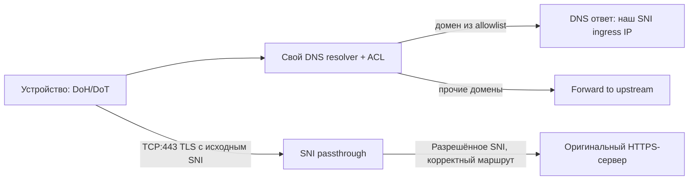

# MNEBYDNS — собственный Smart DNS + выборочный TLS/SNI-прокси

**Статус: архитектура и исследовательский план. Ничего не установлено.**

## Что мы разрабатываем

Отдельный от VPN способ подключения, **без INCY/Happ и без интеграции с Aeternia**. На устройстве настраивается защищённый DNS (предпочтительно DoH или DoT, где поддерживается), а для **строго утверждённого набора HTTPS-сервисов** DNS выдаёт адрес нашего SNI ingress. Для других доменов DNS работает как обычный защищённый resolver через upstream.

Не обещать «весь интернет без VPN». DNS не умеет самостоятельно туннелировать произвольный TCP/UDP, не заменяет VPN, не скрывает IP пользователя от сайтов при обычном резолвинге и не гарантирует работоспособность при операторском allowlisting.

## Поток для разрешённого HTTPS-домена

TLS end-to-end остаётся между приложением и оригинальным origin. **Никакой подмены сертификата / установки корневого CA / перехвата HTTPS.** SNI-прокси считывает имя из TLS ClientHello, не расшифровывает трафик. Если SNI не доступно (в т.ч. из-за ECH), нет соответствия allowlist или адрес назначения опасен — соединение отклоняется/маршрут не активируется. Не создавать открытый TCP forwarder или универсальный SSRF.

## Различие режимов

| Режим | Что защищает/меняет | Ограничения |
|---|---|---|
| Secure DNS-only | запрашивает DNS через DoH/DoT; возможны фильтрация и точечные ответы | сетевой трафик сайтов остаётся обычным; провайдер может блокировать IP/SNI |
| Smart DNS + SNI passthrough | часть TCP HTTPS соединений идёт через наш ingress, TLS остаётся end-to-end | только явные домены, не TCP/UDP произвольно, ECH/QUIC и встроенный DNS приложения могут обойти схему |
| VPN | отдельный туннель по поддерживаемым профилям | требует VPN-клиент, зависит от сети |

## Выбранные компоненты

- **CoreDNS** https://github.com/coredns/coredns как исходный DNS-движок (forward/cache/rewrite/template, Apache-2.0). Не писать DNS-парсер с нуля.
- **DoH/DoT frontend**: проверить штатные возможности конкретной pinned версии CoreDNS и поддержку индивидуальной авторизации; при недостатке выделить компактный authenticated HTTPS gateway. Нельзя называть DoH готовым без contract test на iOS/Android.
- **nginx stream `ssl_preread`** https://nginx.org/en/docs/stream/ngx_stream_ssl_preread_module.html — candidate для L4 TLS passthrough, но текущие nginx конфиги заняты; отдельная карта SNI/ports обязательна.
- **MNEBYDNS policy adapter** (наш код): перечисление разрешённых доменов, DNS rewrite по правилам, выдача и отзыв DNS-профиля, проверка entitlement, управление SNI map, staging/atomic apply/reload и rollback.

Нельзя использовать DNS rewrite «для любого URL» или делать `proxy_pass $ssl_preread_server_name` без строгой проверки назначения. Переключение оригинального DNS имени на IP ingress должно оставлять original SNI/HTTP Host и TLS certificate verification на устройстве. Upstream original адрес определяется **в отдельном резолвинге**, не через собственный переписанный DNS (иначе петля).

## Онбординг и доступ

- iPhone/iPad: проверить создание **подписанного** профиля защищённого DNS (конфигурация iOS/iPadOS; установить вручную по инструкции). Не отправлять конфигурационный профиль с неизвестным CA или VPN без согласия.
- Android: проверить DoT через системный Private DNS (обычно hostname) или иной поддерживаемый механизм; per-user учёт для DoT **не подтверждён**. Нельзя продавать «персональный DoT» до реального решения авторизации.
- Публичная **DoH подписка с отдельным токеном / персональным endpoint** рассматривается только после теста, что системный резолвер корректно применяет URL и что токен/ссылка скрыты. Authenticated transport, rate limits, revoke и аудит попыток — обязательны.
- Профиль Smart DNS привязан к `smart_dns` entitlement; это **не** Remnawave URL. VPN и DNS доступны по одному коммерческому аккаунту, но с разными ключами/правами.

## Security / privacy

Строгий allowlist SNI/domain; отклонение приватных, loopback, metadata и запрещённых адресов; DNS rebinding protection; лимиты QPS и TCP соединений; нулевой доступ к внутренним host/network сервисам. Не логировать DNS-историю пользователя без необходимости, обеспечить TTL/политику хранения и защиту логов. Запрет open resolver без аутентификации или анти-абьюз ограничений.

## Что может не работать

1. QUIC/HTTP3 UDP 443 — не проходит через TCP SNI proxy; приложения могут использовать его без TCP fallback.
2. ECH делает имя сайта недоступным для простого SNI routing.
3. DNSSEC и DNS rewrite могут конфликтовать с проверкой целостности DNS.
4. DoH/DoT может блокироваться или игнорироваться системой/приложением; у клиента может быть собственный DNS.
5. IP/ASN провайдера ingress может блокироваться, особенно в режиме allowlist. **Дорогой спецсервер не гарантирует работу.**
6. CDN, геолокация origin, redirects и вложенные домены требуют матрицы тестов и явных правил.
7. Для ряда сервисов и приложений схема недопустима по условиям эксплуатации; проверять до использования.

## Приёмка PoC без затрагивания proxy production

- Один-две специально выбранные и разрешённые HTTPS-цели; тестовый DNS/ingress на изолированном порту или IP; только тестовое устройство.
- Test: DoH получает ответ, unknown domain forwarded корректно, HTTPS certificate verified без MITM, правильный original SNI, не возникает петли DNS.
- Negative: неизвестный SNI, поддельный Host, ECH, QUIC-only, private IP, DNS rebinding, invalid entitlement, истекший токен, DNS cache TTL.
- Фактическая проверка Android/iOS настроек и работу при смене сети; русские мобильные операторы тестируются отдельно.
- **Go/No-Go:** DNS не считать универсальным VPN; включать в продукт только доказанные сайты и устройства.

Первоисточники: https://coredns.io/plugins/rewrite/ ; https://coredns.io/plugins/template/ ; https://www.rfc-editor.org/rfc/rfc6066.html ; https://www.rfc-editor.org/rfc/rfc9460.html ; https://nginx.org/en/docs/stream/ngx_stream_ssl_preread_module.html .

Aeternia публично описывает **личный DNS, маршрутизацию и ATLAS-клиент**, но внутреннюю реализацию не документирует: https://aeternia.space/offer?lang=en . MNEBYDNS не использует её код, бренд или API.
